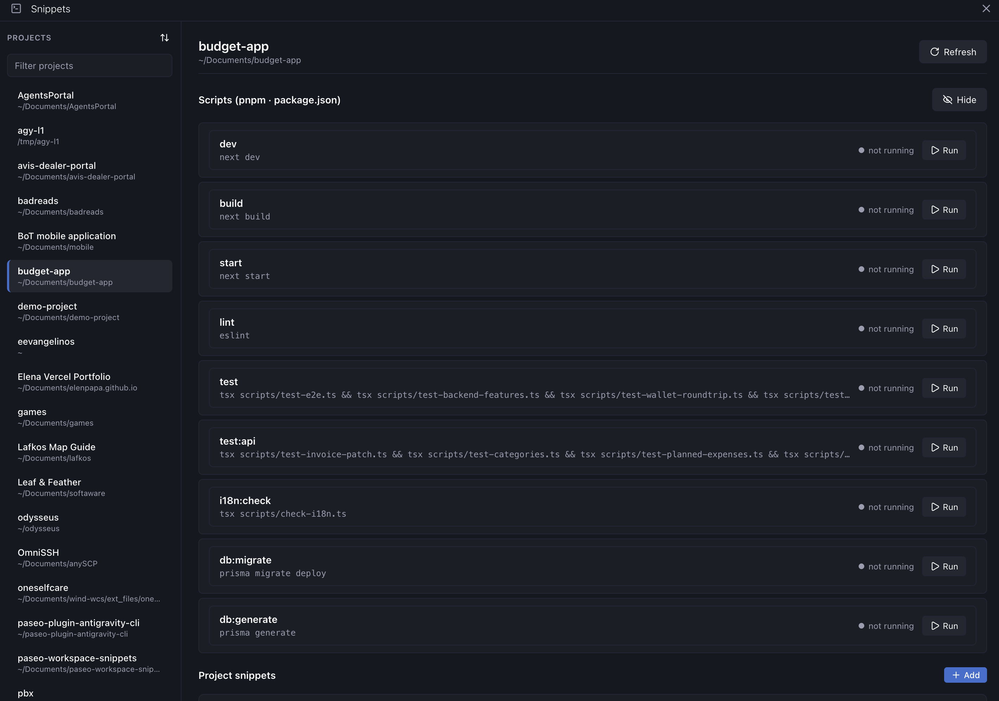
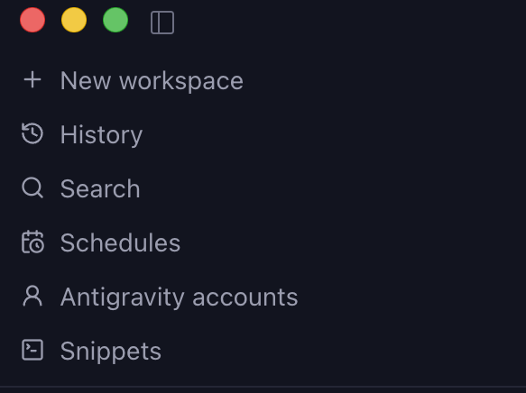
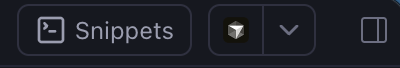
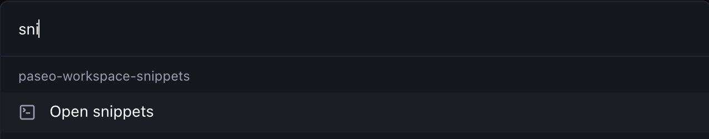

# paseo-workspace-snippets

A Paseo plugin for running command snippets and package.json scripts in workspace terminals.

## What it does

- **Package scripts**: Automatically detects scripts in the root and nested `package.json` files (up to four levels deep) and runs each with its package's Package manager (npm, pnpm, yarn, bun).
- **Shell scripts**: Lists every `*.sh` file in the tree and runs it from the workspace root.
- **Saved snippets**: Save custom commands with project or workspace scope.
- **Terminal orchestration**: Creates and manages interactive workspace terminal tabs with Run, Restart, Stop, Close, and inline output peek.
- **Quick access**: a **Snippets** sidebar screen (works before any workspace exists), a **Snippets** button on every workspace header, Command Center (⌘K "Open snippets"), and the `/snippet <name>` slash command.

## Screenshots









## Install

Requires Paseo 0.10.2 or newer on both the daemon and the app, with **Settings → Plugins → Enable plugins** turned on.

```bash
paseo plugin install npm:paseo-workspace-snippets
# or from GitHub
paseo plugin install github:lefos13/paseo-workspace-snippets
```

You can also paste either source into **Settings → Plugins → Plugin source**. Then run `paseo plugin ls`: `paseo-workspace-snippets` should be `running`, and **Snippets** appears in the sidebar.

## Usage

### Sidebar → Snippets (No Workspace Open)

When starting a session or viewing the **New workspace** screen before any workspace is open, access snippets via the `Snippets` item in the Paseo application sidebar.

- **Project picker & reordering**: Switch between any registered Paseo project. Click the reorder button in the header to customize project order with move up/down/top controls or reset to A–Z, persisted in plugin settings.
- **Scripts, Shell scripts and project snippets**: Lists Scripts grouped by Package, Shell scripts grouped by folder, and project-scoped snippets for the selected project. (Workspace-scoped snippets require an active workspace and are not shown).
- **Local workspace orchestration**: Clicking **Run** opens (or reuses) the project's Local workspace (`directory === projectRootPath`), executes the command in a dedicated terminal tab (`script:<name>`, `script:<package>/<name>`, `shell:<path>` or `snippet:<name>`), and navigates directly to that workspace.
- **Lifecycle actions**: When a Local workspace is already active for the selected project, entries reflect live open status with **Restart**, **Stop**, **Close**, and terminal output peek.

### Workspace Panel

Open the Snippets panel through:
- The `Snippets` button in the workspace header.
- The `Snippets` tab in the workspace panel bar or explorer sidebar.
- Command Center (⌘K) search for "Open snippets".
- The `/snippet` slash command with no arguments.

The panel contains three sections:
- **Scripts**: Auto-detected scripts from the workspace's `package.json` files, one collapsible group per Package labeled `<folder> · <pm>` (`root` for the Root package). The Root group starts expanded and Nested groups start collapsed; Packages without Scripts are hidden, and a broken Nested `package.json` shows its error inside its group. Use the `Hide`/`Show` toggle to collapse the section.
- **Shell scripts**: Every `*.sh` file, one collapsible group per folder (`root` for the workspace root). Folder groups start expanded and the section has its own `Hide`/`Show` toggle.
- **Snippets**: Custom shell commands. Click `Add` to create new snippets, or `Edit`/`Delete` on existing rows.

Group collapse state is remembered per project for the current app session, not saved to settings. Click `Refresh` in the panel header to rescan Packages and Shell scripts.

### Entry Actions

- **Run**: Creates a dedicated terminal tab named `script:<name>`, `script:<package>/<name>`, `shell:<path>` or `snippet:<name>` and executes the command. Nested Scripts run in a subshell that `cd`s into their Package folder, so the terminal's own working directory is unchanged and **Restart** can re-send the same command. Shell scripts and Snippets run from the workspace root.
- **Restart**: Sends `C-c` to interrupt any existing process, waits briefly, and executes the command again.
- **Stop**: Sends `C-c` to interrupt the running command without closing the terminal tab.
- **Close**: Terminates and closes the terminal tab.
- **Output preview**: Click the chevron on any row to view the last 40 lines of terminal output in an expandable peek without leaving the panel.

### Slash Command

In any workspace composer or agent prompt:
- `/snippet <name>`: Runs the matching Snippet, root or Nested Script, or Shell script. Resolution order:
  1. Exact Snippet name.
  2. Exact Root package Script name.
  3. Exact Shell script relative path.
  4. Exact Qualified name (for example `apps/web/dev`).
  5. A unique case-insensitive match: Snippets and Scripts by prefix on their name or Qualified name; Shell scripts by exact full path, or exact basename with or without `.sh` (so `deploy` runs `scripts/deploy.sh`).

  If nothing matches, or several entries do, the candidates are listed.
- `/snippet`: Opens the Snippets workspace panel.

## Scope: Project vs Workspace

When adding or editing a snippet:
- **This project**: Keyed by `projectRootPath`. Available across every worktree of the project.
- **This workspace**: Keyed by the workspace `directory`. Scoped strictly to that specific working directory.

## Discovery

The plugin walks the workspace root and every folder below it, up to four levels deep (the root is level 0). It stops after 50 Packages and skips `node_modules`, `.git`, `dist`, `build`, `.next` and any dot-folder. It does not read `.gitignore` or workspace declarations (`workspaces`, `pnpm-workspace.yaml`): any folder with a `package.json` is a Nested package. Symlinked folders are not followed. A symlinked `package.json` must resolve inside its own Package folder, and a symlinked `*.sh` file must resolve inside the workspace.

Packages without Scripts are hidden, and a broken `package.json` (Root included) shows its error inside its group without hiding the other Packages. When the 50-Package cap is hit, or a folder at the depth limit still holds a `package.json` or `*.sh` below it, the Scripts section shows "Scan hit its limit; some Packages may be missing." Plain source folders at the depth limit do not trigger the note.

Shell scripts are every `*.sh` file found by the same walk. An executable file runs as `./<path>` (honouring its shebang); a file without the executable bit runs as `bash <path>`. Both run from the workspace root and take no arguments. Terminal tabs are named `shell:<path>`.

### Qualified Names and Commands

A Root package Script keeps its bare name (`dev`, terminal tab `script:dev`). A Nested package Script uses `<folder>/<name>` (for example `apps/web/dev`, terminal tab `script:apps/web/dev`), so two Packages can both have a `dev` Script. Nested Scripts run as `(cd <folder> && <pm> run <name>)`; Root Scripts run as `<pm> run <name>`.

### Package Manager

For each Package, the Package manager is detected in order:
1. `packageManager` field in that Package's `package.json` (for example `"pnpm@9.1.0"` or `"npm@10.0.0"`).
2. A lockfile in the Package folder: `pnpm-lock.yaml` -> `pnpm`, `yarn.lock` -> `yarn`, `bun.lockb` or `bun.lock` -> `bun`.
3. The nearest ancestor Package's Package manager, up to the workspace root.
4. `npm`.

Commands use that Package manager's `run` (`pnpm run dev`, `(cd apps/web && yarn run build)`). Names containing characters outside `[A-Za-z0-9:._/-]` are shell-quoted.

## Relation to paseo.json Scripts and Services

`paseo.json` scripts are committed with the repository and run in supervised processes with ports and proxies. This plugin provides personal, interactive, zero-config terminal shortcuts.

| | `paseo.json` scripts/services | This plugin |
|---|---|---|
| Where defined | Committed file, read from the base branch | Host-local settings + live `package.json` files and `*.sh` scripts |
| Needs a commit / config | Yes | No |
| Supervision, ports, proxy, health | Yes (services) | No: a plain interactive shell |
| Environment | `PASEO_*` variables | The user's login shell (nvm, PATH, direnv) |
| Who sees it | Everyone who clones the repo | Only this daemon host |

Use `paseo.json` services for team-shared dev servers that require ports or supervision. Use this plugin for personal workflow commands and ad-hoc scripts.

## Limitations

- **Process state**: Commands run interactively in the user's default shell. Paseo does not expose process exit codes to plugins; the plugin tracks whether the terminal tab is open or closed, not whether a process inside it has completed.
- **Supported script types**: Only `package.json` scripts and `*.sh` files are detected. Makefile targets, `justfile` recipes and other formats are not.
- **Shell script arguments**: Shell scripts run without arguments; save a Snippet that calls the script with arguments instead.
- **Terminal tab focus**: Creating a new terminal tab immediately focuses that tab in the Paseo workspace.
- **Host-wide settings**: Snippets are stored in plain JSON in host-level daemon plugin settings. Do not store sensitive secrets or credentials in snippets.

## Develop

When the Paseo CLI is not on your `PATH`, use the full application binary:
```bash
PASEO=/Applications/Paseo.app/Contents/Resources/bin/paseo
```

Commands:
```bash
npm install
npm run typecheck
$PASEO plugin install "$PWD"
$PASEO plugin reload paseo-workspace-snippets
$PASEO plugin ls
$PASEO plugin logs paseo-workspace-snippets
```
